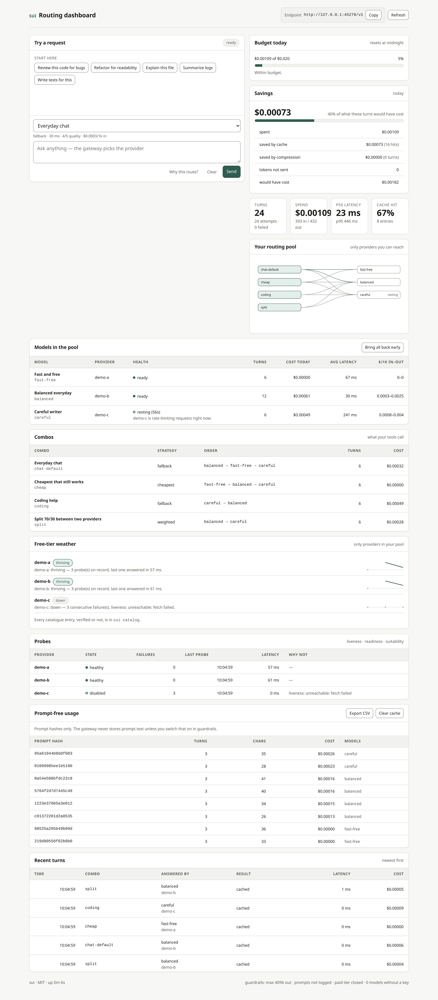

# Sui

**A free-tier AI gateway that proves a route before it takes it.**

Point Cline, Continue, Cursor, Aider or your own app at one endpoint. Sui picks a provider that is actually answering, refuses to spend money unless you open the gate, and tells you in plain language why each request went where it did.

```bash
./sui            # macOS / Linux
.\sui.cmd        # Windows
```

One command: find the keys on this machine, find your coding tools, write a config, send a real request through the gateway, print the endpoint, start serving. If nothing can answer, it says so, because success requires a real round-trip through the gateway.



## Why this exists

Every free-tier router I could find answers the same way: try something, and if it fails, try the next one. That works until it doesn't — you cannot tell a provider that is down from one that was never reachable, and a "free" router that quietly falls back to a paid key is the most expensive thing in your stack.

Sui makes three things non-negotiable:

| | |
|---|---|
| **Verified, not assumed** | A route becomes routable by answering a probe. `sui probe --write` promotes what responded; nothing is routable because someone wrote a URL in a file. |
| **Spending requires a decision** | Paid credentials are not read at all unless you set `paidTiers.enabled`. Not "warned about" — not opened, not decrypted, not in the environment. |
| **Every claim has a test** | Nineteen invariants, each with the module that enforces it and the test that proves it. `npm test` fails if one loses either. |

## Install

Node 20 or newer. Zero runtime dependencies, no build step, no native modules — so nothing to compile and no `node-gyp`.

```bash
git clone https://github.com/drsamonline/sui
cd sui
npm install
./sui                 # or: .\sui.cmd on Windows
```

**Not on npm yet**, so `npx sui` has nothing to download. The wrapper above runs the source directly; `npm link` gives you a global `sui` if you want one. Windows, step by step: [`docs/WINDOWS.md`](docs/WINDOWS.md).

Then anything that speaks OpenAI:

```bash
export OPENAI_BASE_URL=http://127.0.0.1:8787/v1
export OPENAI_API_KEY=sui-local
```

## What you get

Ten things people actually come for. The full list — forty-odd features across routing, privacy, compression, agents and operations — is in [`docs/FEATURES.md`](docs/FEATURES.md).

- **OpenAI-compatible gateway**, streaming and not, with four strategies over virtual model names: `fallback`, `weighted`, `cheapest`, `latency`.
- **Free-first ordering.** A free target outranks a paid one whatever order you declared them in, and a resting target loses to a healthy one.
- **A circuit breaker that knows the difference** between a broken provider (5xx, transport) and a rejected key (401). A bad key never rests a route.
- **Budgets that cannot be fooled** — daily and per provider, counted from a per-day total rather than a memory window, so a busy day does not silently stop counting.
- **Prompt compression** — seven engines behind four presets, canonicalisation first, with code, URLs and JSON preserved byte-for-byte. Off by default; `sui compress` shows you the result first.
- **Verification and grounding** — answers scored on deterministic signals; a URL, quote or number not present in the context costs confidence and usually escalates.
- **Explain my route** — `sui explain` narrates why a request would go where it goes, without sending anything.
- **MCP in both directions** — the gateway as a Model Context Protocol server (stdio or HTTP), and an MCP server as just another provider inside a combo.
- **A dashboard** that answers "is anything wrong?" in one look: budget, routing topology, free-tier weather, breaker states, savings, and a playground with "Why this route?".
- **A sandbox** for model-written code: a separate process with no filesystem, no network and no environment, proven by a 14-case attack suite.

## How it holds itself

Nineteen invariants live as data in [`packages/core/src/invariants.js`](packages/core/src/invariants.js). Each names the module that enforces it and the test that proves it, and the build fails if either goes missing.

| | |
|---|---|
| **I4** | Paid credentials are never read unless the gate is open. |
| **I7** | Onboarding cannot report success without a real model round-trip. |
| **I11** | No prompt content in telemetry — a salted hash and a length. |
| **I12** | A provider marked `tos: avoid` is never auto-routed. |
| **I13** | The breaker trips on 5xx and transport only — never on 401, 404 or 429. |
| **I19** | The health history holds no prompt content, and drops any row that carries it. |

Run `npm test`, `npm run audit` (8 static checks plus 10 ADR compliance checks), `npm run eval:self`, `npm run soak`, `npm run smoke:dashboard`. The numbers, as of this commit: **589 tests, audit 8/8, ADR 10/10, p95 overhead 2.19 ms against a 15 ms budget from 1,200 samples.**

What each number rests on — sample sizes, confidence intervals, and where a figure stops being useful — is in [`docs/MEASUREMENT.md`](docs/MEASUREMENT.md). How it compares with [OmniRoute](https://github.com/cheaper-inference/OmniRoute), including where that project is further ahead, is in [`docs/COMPARISON.md`](docs/COMPARISON.md).

## Documentation

| Start here | Then |
|---|---|
| [`docs/WINDOWS.md`](docs/WINDOWS.md) — setup on Windows, without npm | [`docs/ARCHITECTURE.md`](docs/ARCHITECTURE.md) — modules and the request lifecycle |
| [`docs/FEATURES.md`](docs/FEATURES.md) — everything it does | [`docs/ROUTING.md`](docs/ROUTING.md) — strategies, breakers, budgets, cache |
| [`docs/tutorials/`](docs/tutorials/) — seven walkthroughs | [`docs/API.md`](docs/API.md) — every endpoint and field |
| [`docs/quickstarts/`](docs/quickstarts/) — cURL, Node, Python, PHP | [`docs/adr/`](docs/adr/) — twelve decisions and their consequences |

MCP: [`docs/MCP.md`](docs/MCP.md) · two-plane split: [`docs/PLANES.md`](docs/PLANES.md) · sandbox: [`docs/SANDBOX.md`](docs/SANDBOX.md) · recipes: [`docs/RECIPES.md`](docs/RECIPES.md) · migrating from another router: [`docs/MIGRATION.md`](docs/MIGRATION.md).

## Status

Everything in the specification is built. What is left needs a networked machine, a provider key, or a decision — listed in [`ROADMAP.md`](ROADMAP.md) and stated plainly rather than hidden:

- the 41 catalogue endpoints are seeded but **unverified** until you run `sui probe --write` on a machine with internet
- no eval baseline is recorded, because that needs one working provider key
- the 72-hour soak has not been run
- nothing is published to npm

Two things are deliberately absent: a **first-chunk clone** (two providers billed for one answer is a real cost for a fake latency win) and a **Go/Rust data plane** (ADR-0001's gate says p95 2.29 ms at 200 rps, seven times under budget).

## Contributing

Read [`CONTRIBUTING.md`](CONTRIBUTING.md) first. The short version: every claim here has a test that fails if the claim stops being true, and the five harnesses above are the gate.

## Licence

MIT for everything in this repository, including the vendored kits — those come from the owner's own repositories under PolyForm Noncommercial and are distributed here under a written owner grant ([`docs/legal/OWNER_GRANT.md`](docs/legal/OWNER_GRANT.md)). Upstream keeps its NC terms for everyone else.

Legal index, with what each document answers and the code to check each claim against: [`docs/legal/LEGAL-INDEX.md`](docs/legal/LEGAL-INDEX.md).

---

Two audits live in the repository rather than in a message: [`AUDIT.md`](AUDIT.md) and [`AUDIT-2026-11-15.md`](AUDIT-2026-11-15.md). Each records what was found, what was fixed, and what is an accepted risk.
