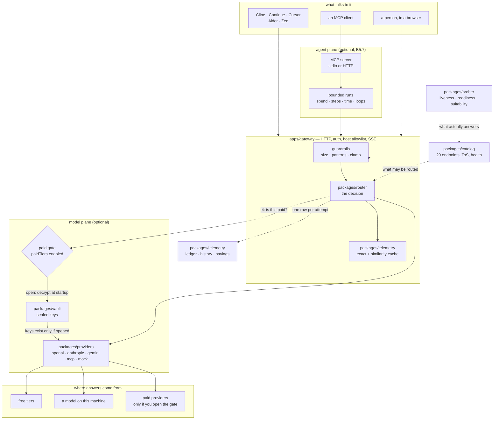

# Architecture

Sui is an npm-workspaces monorepo with one direction of dependency. Nothing below `packages/router` knows about HTTP; nothing above it knows a provider's wire format.

## The shape of it



Two things in that picture are the whole design.

**The prober feeds the catalogue, and the catalogue feeds the router** — a route exists because something measured it, not because someone wrote a URL.

**The gate is a branch in the startup path, not a flag that hides a key.** When `paidTiers.enabled` is false the vault file is never opened, so the key does not exist in memory and no routing decision can conjure it. The router's check (`isPaidProvider` in `packages/core/src/config.js`) is the second line; the first is `apps/gateway/src/index.js`, which does not call `openVaultForStartup` at all.

```
apps/cli ───── apps/dashboard (static)
    │
apps/gateway (HTTP, auth, SSE, dashboard API)
    │
    ├── packages/router ── packages/guardrails
    │        │
    │        └── packages/providers
    │
    ├── packages/telemetry (ledger, cache)
    ├── packages/catalog   (dedupe, ToS posture, scoring)
    └── packages/core      (errors, config, cost, invariants)
```

| Module | Owns | Never does |
|---|---|---|
| `packages/core` | config schema + validation, error taxonomy, cost model, the invariant table and its audit | I/O at request time |
| `packages/router` | the decision: which target, in what order, what happens when one fails; the breaker | speak a provider's protocol, touch HTTP |
| `packages/providers` | wire formats: openai, anthropic, gemini, mock | decide anything about routing |
| `packages/guardrails` | prompt size, blocked patterns, output clamp | know which provider will answer |
| `packages/telemetry` | append-only ledger, TTL cache, aggregates, CSV | block a request |
| `packages/catalog` | catalogue entries, dedupe by `pool_key`, ToS states, health scoring | route anything by itself |
| `packages/sdk` | a client for the gateway | make routing decisions |
| `apps/gateway` | HTTP, auth, host allowlist, SSE, dashboard API | decide routing |
| `apps/cli` | the human path: detect, validate, print, migrate | be the only way in |
| `apps/dashboard` | the human surface: tokens, topology, provenance chips | hold business logic |
| `packages/kits` | loading the vendored kits in an isolated `node:vm` context, and reporting their status | let a kit touch a host global (ADR-0007) |
| `packages/vault` | sealing paid credentials with AES-256-GCM, opening them only when the gate is on | decide policy (that is I4, in core) |

## Request lifecycle

```
POST /v1/chat/completions { model: "chat-default", messages: [...] }
  │
  ├─ server: auth (apiKey → allowedCombos, allowedModels)          → 401/403
  ├─ server: does this name a combo or a model?                     → 404 with the list
  │
  ├─ router: normalise messages, estimate prompt tokens
  ├─ router: guardrails — input size, blocked patterns              → 413/400
  │
  ├─ router.plan(combo)
  │    for each declared target, in declared order:
  │      declared in models?            no → skip "not declared"
  │      allowed for this key?          no → skip "not allowed for this API key"
  │      has credentials?               no → skip "no API key set (ENV_NAME)"
  │      breaker allows an attempt?     no → skip "resting after a failure (retrying in Ns)"
  │      daily budget left?             no → skip "daily budget reached"
  │      provider budget left?          no → skip "provider budget reached"
  │      clears the quality floor?      no → skip "quality N is below the floor of M"
  │    then order by strategy (fallback / weighted / cheapest / latency)
  │
  ├─ router: cache lookup (non-streaming only)                      → hit: return, mark cached
  │
  ├─ for each target in order:
  │     breaker allows? ── adapter.chat() ── ok ── breaker.success, ledger.record, return
  │                                      └─ err ─ breaker.failure, ledger.record(failed)
  │                                                committed? → stop, report stream_interrupted
  │                                                retryable? → next target
  │                                                else       → stop
  │
  └─ nothing left → ExhaustedError: 503 with every reason attached
```

The plan is computed once per request and is pure — no network, no mutation. That is what makes `router.plan()` testable without a provider, and what makes "why did this go to Gemini?" answerable from the same code path that made the decision.

## Invariants in the code

`packages/core/src/invariants.js` holds all fifteen as data: statement, the module that enforces it, the test that proves it, and — for anything not fully enforced — the gap in plain words. `test/invariants.test.js` fails if an invariant loses its enforcement point or its test. Three places worth knowing:

- **I4** (paid air-gap) is checked inside `providerHasCredentials()` *before* the environment is read, so a paid key present in `.env` cannot produce a paid request while the gate is closed.
- **I12** (ToS) and **I14** (no total outage) live in `Router#plan`: `tos: avoid` targets are skipped unless the caller named that model, and targets whose breaker is open are held in a `resting` bucket that is tried only after every healthy target has failed.
- **I13** (breaker tripping) is one exported function, `tripsBreaker()`, so "5xx and transport only" is a test, not a comment.
- **I4 + B6.7** are two halves of one boundary: `providerHasCredentials()` decides *whether* a paid key may be read, and `packages/vault` decides *where* it lives (sealed, opened at startup only when the gate is open).

## Vendored kits

`vendor/kits/` holds seven single-file kits from the same fleet, each with its upstream `LICENSE` and generated `API.md`, pinned to a commit in `docs/legal/LICENSE_INVENTORY.md`. `packages/kits` evaluates them in a `node:vm` sandbox rather than importing them, because they are browser IIFEs that attach globals. What each one powers is listed in `ROADMAP.md`.

## Decisions worth explaining

**The ledger records failures too.** A failed attempt is not a turn, but it is evidence. `totals.turns` counts answers; `totals.attempts` counts requests to providers; `totals.failed` counts the gaps. Without that split, a flaky primary would look like extra traffic instead of a reliability problem.

**Cost comes from the model, not from the response.** Providers do not agree on what they report, and some report nothing. Each model declares `costPer1kIn` / `costPer1kOut`, and the ledger multiplies. It is an estimate with one source of truth, not a guess assembled from three.

**Cached turns keep their price.** A cache hit records the cost it would have incurred, so `totals.savedUsd` is a real number and "we spent less this week" has a cause attached.

**Prompt text is not stored by default.** The ledger keeps a salted hash and a character count. That is enough to spot the same prompt being routed forty times (and priced forty times) without holding anyone's code. `guardrails.logPrompts` turns storage on deliberately.

**Streaming commits on first token.** Before the first token, a failure is invisible: the router can try the next target and the client sees one clean answer. After the first token, it cannot — so it stops and says so. This is the one place where the router deliberately chooses an error over a silent switch.

**Adapters are created lazily and cached per provider.** One adapter per provider per gateway, so a config reload (restart) is the only time wiring changes.

**The toggle gate is a pure function in `config.js`, not a UI rule.** `checkToggle()` is called by `POST /api/config/validate` and could be called by the CLI. A rule that only exists in the dashboard is a rule that will disagree with the CLI within a month.

## Data

```
$SUI_HOME/ledger.jsonl    one JSON object per line, append-only, capped in memory
$SUI_HOME/                 default ~/.sui
./sui.config.json          the config (yours, in your repo)
```

A ledger line:

```json
{"ts":1763000000000,"provider":"groq","model":"llama-3.3-70b-versatile","modelId":"groq-70b",
 "combo":"chat-default","arm":null,"ok":true,"error":null,"promptTokens":412,"completionTokens":96,
 "costUsd":0.00032,"latencyMs":812,"ttftMs":240,"cached":false,"verified":true,
 "promptHash":"9f2c…","promptChars":1840,"streamed":true}
```

Appending is synchronous and wrapped in a try/catch: observability must never be the reason a request fails.

## Extending

**A new provider wire format.** Add a `chat(request, opts)` function to `src/providers/index.js` that returns `{ text, usage: { prompt_tokens, completion_tokens }, finishReason, raw }`, call `opts.onToken(delta)` for each streamed chunk, and throw `ProviderError` with `retryable` set honestly. Register it in `createAdapter` and add the type to `PROVIDER_TYPES`.

**A new strategy.** Add it to `STRATEGIES` in `config.js`, then to the ordering block in `Router#plan`. Ordering is the whole contract: execution is strategy-agnostic.

**A new dashboard view.** Add an endpoint to `server.js` and render it in `web/dashboard.html`. Keep the token discipline: `var()` only, no raw colours, numbers in `font-variant-numeric: tabular-nums`.
